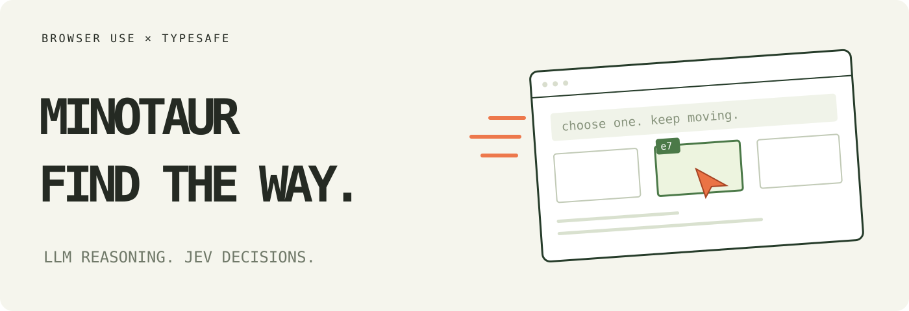

# Minotaur

> [!IMPORTANT]
> **The Browser Use Cloud waitlist is open.** Get early access to ultrafast browser agents in the cloud.
> **[Join the waitlist →](https://browser-use.com/ultrafast?utm_source=github&utm_medium=readme&utm_campaign=jev-ultrafast)**

**The body of an LLM. The head of Jev.**

Minotaur is a browser agent that pairs a language model’s planning, reading, and writing with Jev’s fast browser decisions. Like its namesake, it brings two halves together to find a path through the maze of the web.

**A browser agent with a dynamic, indexed action space.**

Give it one goal. [TypeSafe's Jev](https://docs.typesafe.ai/introduction) picks an operation and an element. A small LLM writes text only when the operation is `TYPE_TEXT`.

**Original demo: Zürich → London on Google Flights in 7.1 seconds.** One natural-language goal, actual text generation, and loading waits included. This historical measurement is for the original navigation agent; current research-suite results are reported separately below.

<a href="docs/demo.mp4"></a>

[Watch the MP4](docs/demo.mp4) · [Measurements](docs/performance.md) · [Read the loop](jev_ultrafast/agent.py)

## The action space

Every observation produces a new element table:

```text
[1] button    Change ticket type · Round trip
[2] combobox  Where from?        · San Francisco
[3] combobox  Where to?          · empty
[4] textbox   Departure          · empty
...
```

The operations are `CLICK`, `TYPE_TEXT`, `PRESS_ENTER`, `SELECT`, `SCROLL_UP`, `SCROLL_DOWN`, `WAIT`, `DONE`, and `BLOCKED`. Only supported operations and targets are offered.
`PRESS_ENTER` focuses an observed single-line input or search/combobox field and presses Enter
to submit its current value or accept a suggestion. Ordinary multiline editors do not offer it.

```text
                      one TypeSafe request
                     ┌───────────────────────────┐
page → element table → operation                 │
                     │ click_target              │
                     │ type_text_target          │
                     │ press_enter_target        │
                     │ select_target, if present │
                     └─────────────┬─────────────┘
                         use the matching target
                                   │
                    CLICK [7] ─────┤──→ browser
                TYPE_TEXT [3] ─────┘
                          ↓
                   small LLM → text → browser
```

Target questions are speculative. If the operation is `CLICK`, only `click_target` can execute. Two decisions, **one network round trip**. Each target head contains only compatible elements. Native dropdown choices carry an observed element/option index.

There are no site-specific action scripts or prepared field strings in the policy. The Flights example supplies a goal and independently verifies the outcome. The screenshot renderer adds labels afterward; it does not drive the browser.

## Try the Minotaur web view

Run `uv run --env-file .env jev-web` and open **http://127.0.0.1:8767**. Enter a goal on the home page to open a fresh console at `/runs/<id>`. Each run has its own browser, controls, activity, answer, and trace. Return home to start another task without replacing existing runs; recent task links stay in this browser. Cloud tasks require Browserbase credentials in addition to the model keys (see `.env.example`).

## Deploy the Minotaur console to Vercel

The Vercel adapter serves the console through a Node function and runs each Python task
in its own Vercel Sandbox. A separate signed HttpOnly cookie for each run reconnects its console to the correct task;
worker state and audit traces survive function restarts. Finished sandboxes are stopped
when the console observes completion; their snapshots expire after 24 hours. Download
traces before then. Browserbase sessions retain the 15-minute service timeout and tasks
retain the 14-minute application limit. An expired worker is never automatically retried.

Run `npm ci`, link a Vercel project, and configure the server-side variables from
`.env.example` plus a random `CONSOLE_SESSION_SECRET` of at least 32 bytes. Enable Vercel
OIDC for Sandbox access and Vercel Authentication for all deployments before sharing the
console, since tasks use the configured model and browser accounts. Then run
`vercel deploy --prod`. Source packaging excludes credentials and local traces. The
existing `jev-web` command remains available for local use. `npm test` checks task
validation and signed session isolation without external APIs.

## Try the original inspector

```bash
git clone https://github.com/browser-use/jev-ultrafast.git
cd jev-ultrafast
uv sync
cp .env.example .env
# Add TYPESAFE_API_KEY and TEXT_MODEL_API_KEY.
uv run jev
```

Open **http://127.0.0.1:8766** and click **Start demo → Run automatically**. The inspector shows numbered elements, operation probabilities, target probabilities, and executed actions. **Choose next** pauses before execution.

Chrome connects through [Browser Harness](https://github.com/browser-use/browser-harness), installed by `uv sync`. Run `uv run browser-harness --doctor` if it needs connecting. Allow remote debugging in Chrome when prompted.

The example configuration defaults to OpenRouter with `inception/mercury-2.5`. You can instead use your OpenAI key directly; OpenRouter is not required:

```dotenv
TEXT_MODEL_API_KEY=your_openai_key
TEXT_MODEL_BASE_URL=https://api.openai.com/v1
TEXT_MODEL=gpt-6-luna
TEXT_MODEL_REASONING=none
```

The text model uses **Chat Completions**, not Responses. TypeSafe uses its separate
SystemOne API and still needs `TYPESAFE_API_KEY`. In research mode the text model also
plans, extracts, resolves uncertain decisions, reviews evidence, repairs citations, and
writes answers. Credentials stay in the ignored `.env`; never put them in goals or traces.

## Use the library

```python
from jev_ultrafast import Agent
from datetime import date, timedelta

departure = (date.today() + timedelta(days=60)).isoformat()

with Agent(
    "https://www.google.com/travel/flights?hl=en",
    f"Find one-way flights from Zurich to London on {departure}, "
    "for one adult in economy. Stop when matching flight options are visible.",
) as agent:
    for state in agent.run():
        print(state["elapsed_ms"], state["status"])
```

Run with `uv run --env-file .env python your_script.py`. The same policy can run a different task:

```bash
uv run --env-file .env python examples/run.py \
  --url https://en.wikipedia.org/wiki/Main_Page \
  --goal 'Find and open the Wikipedia article about Gödel’s incompleteness theorems.'
```

`examples/flights.py` preserves the original September 20, 2026 goal and independent
oracle for historical reproduction; that date is now in the past. For current Flights
testing, use `jev-live-suite --only flights` with its future-date default or an explicit
`--flight-date`. The example does not select or book a flight.

## Experimental planning and research

`ResearchAgent` adds sequential outcome-based planning and document reading around the
same guarded executor. Jev chooses a browser operation or an indexed passage to read;
the text helper extracts facts with exact source quotes. Separate checks assess subtask
requirements, the original goal, and the final answer before reporting completion.
Before rewriting or suppressing rejected statements, a bounded citation-repair pass looks
for support in uncited captured evidence. It replaces numeric references without rewriting
claims, validates every evidence ID, and independently rechecks the repaired answer.
If the revised answer still contains unsupported statements, those statements are removed.
The remaining statements and original goal are checked again before publishing, so removing
an essential requirement or qualification cannot silently turn a failed task into a success.
Rejected drafts and suppressed statements remain in the trace. Unsupported here means a
statement failed the model's evidence check; it is not a definitive determination of falsehood.

```python
from jev_ultrafast import ResearchAgent

with ResearchAgent(url, "Compare annual prices and cancellation conditions.") as agent:
    for state in agent.run():
        print(state["status"], len(state["evidence"]))
    print(agent.result)
```

The installed CLI is `jev-research --url URL --goal 'Your goal'`; the equivalent wrapper
is `uv run --env-file .env python examples/research.py`. It saves an audit trace under ignored
`artifacts/`. This version owns one tab and allows two planning recoveries; it
does not yet attach to your existing tabs or resume saved runs. Model verification is fallible.
The existing inspector and speed measurements describe the original `Agent`.

[Local test plan, fixture commands, and current limits](docs/research-testing.md).
[Live results: historical fixture tests and the seven-task refinement suite](docs/research-live-results.md).
`uv run python scripts/check_research.py` exercises a real local browser with
model doubles and an independent fixture oracle, without paid API calls.

Run the research CLI with a dedicated local Chrome process:

```bash
# Headless is the default; --headless can also be supplied explicitly.
uv run --env-file .env jev-research \
  --url https://en.wikipedia.org/wiki/Main_Page \
  --goal 'Find and summarize the two incompleteness theorems with sources.'

# Show Chrome and bring the agent tab to the foreground.
uv run --env-file .env jev-research --headfull \
  --url https://en.wikipedia.org/wiki/Main_Page \
  --goal 'Find and summarize the two incompleteness theorems with sources.'
```

The same flags work with `uv run --env-file .env python examples/research.py`.
Each CLI run uses a fresh temporary Chrome profile and its own Browser Harness
connection, so it does not inherit your usual browser logins. Chrome and that
connection close when the run exits. Set `JEV_CHROME_BIN` to your Chrome executable
if it is not found automatically. The Python library and original inspector
continue to use their existing Browser Harness connection.
The agent owns one task tab, but startup currently also creates Chrome's blank tab and
Browser Harness's dedicated tab, so a visible run can show three tabs. Tab reuse has not
yet been implemented.

In `--headfull` mode with an interactive terminal, recognized CAPTCHA/human-verification
pages pause the agent. Solve the challenge in Chrome, then press Enter in the terminal
to resume the same run with a fresh observation. Type `q` to stop. Headless or
noninteractive runs stop with an actionable reason. Detection covers common visible
challenge messages; it may miss challenges embedded in frames or using other wording.

## Why it moves

- **One primary Jev request per decision.** Operation and target heads share the same observed state. Research slow paths, extraction, and verification can add model calls.
- **No screenshots in the default agent loop.** Jev consumes structured state. The inspector opts into screenshots; the video uses a separate continuous screencast.
- **One browser call per snapshot.** Read visible controls, their names, values, and text atomically. Keep references to the actual DOM nodes.
- **Validate the selected target.** Clicks check the document, form values, target, and nearby context. Animation alone does not force another prediction. Resolve current geometry and reject covered controls before input.
- **Wait for useful state.** After typing into a combobox, wait for visible suggestions, capped at 200 ms. Other interactions get at most two animation frames or 50 ms. These reads happen after execution is logged.
- **Keep hidden tabs rendering.** Focus emulation prevents background animation throttling without switching Chrome's visible tab.
- **Separate controls from document content.** Navigation offers reachable viewport controls. Research also captures rendered offscreen passages in bounded reading windows.
- **Reuse an interrupted text request.** A generated value survives a stale-page retry only if the entire text-helper input is unchanged.

Every executed target is resolved from an observed node. The executor rechecks page freshness and click occlusion. Model output never becomes selectors, coordinates, shell commands, or executable JavaScript. Text-helper output must parse as a small JSON object before typing.

## Small enough to read

| File | Job |
| --- | --- |
| [agent.py](jev_ultrafast/agent.py) | The complete loop and text-helper handoff |
| [snapshot.js](jev_ultrafast/snapshot.js) | Atomic DOM snapshot, indexed controls, freshness guards |
| [browser.py](jev_ultrafast/browser.py) | Browser connection, current geometry, execution |
| [model.py](jev_ultrafast/model.py) | Dynamic operation/target heads and text generation |
| [questions.py](jev_ultrafast/questions.py) | Model instructions |
| [demo.py](jev_ultrafast/demo.py) | Local inspector |
| [research.py](jev_ultrafast/research.py) | Planning, reading, evidence, verification, citation repair and answer recovery |
| [content.js](jev_ultrafast/content.js) | Rendered document capture, semantic paragraphs and observed link tooltips |
| [cli.py](jev_ultrafast/cli.py), [launch.py](jev_ultrafast/launch.py) | Owned Chrome lifecycle and human CAPTCHA handoff |
| [live_suite.py](jev_ultrafast/live_suite.py) | Sequential opt-in live tests and saved summaries/logs |

## Evidence and limits

The current video is a **7,073 ms** Google Flights run. Timing starts after initial page observation and includes model calls, generated text, browser work, stale decisions, and loading waits. A fresh independent check verifies the one-way setting, Zürich, London, September 20, 2026, and visible flight options. The video plays at 1×, with no opening hold and a 0.5-second final hold.

In six alternating runs with identical models and settings, both versions passed **3/3**. Median task time went from **9.450 s → 7.092 s**, a **25% reduction**; median browser protocol calls went from **1,092 → 101**. This is three repeats of one task on one browser profile, not a general reliability benchmark.

The same policy opened the requested Wikipedia article in **2.798 s** and passed a local hotel search/filter task in **1.896 s**. Runs, failures, source hashes, and measurement boundaries are in [performance.md](docs/performance.md).

A `DONE` choice still requires separate outcome verification. Research verification is model-based and fallible; the local fixtures use independent oracles. The DOM reader handles common HTML and ARIA controls, not the full accessible-name specification. Shadow roots, frames, canvas, uploads, pop-up tabs, nested scrolling, and arbitrary keyboard widgets remain outside this MVP. Library-owned tabs use the existing Browser Harness profile; CLI runs use fresh isolated profiles.

In the latest seven-task pass, six tasks completed and Google/Python was CAPTCHA-blocked
without human assistance. Flights and both previously failing Books tasks completed;
Gödel and book identifiers took longer than the baseline. These are single-run custom
smoke tests, not benchmark scores. See the [comparison and audit scope](docs/research-live-results.md).

## Development

Run the opt-in live smoke suite sequentially (uses paid model calls from `.env`):

```bash
uv run --env-file .env jev-live-suite --headfull
# Select tasks, repeat them, or set a specific future flight date:
uv run --env-file .env jev-live-suite --headfull --only wikipedia-webb books-identifiers --repeat 3
uv run --env-file .env jev-live-suite --headfull --only flights --flight-date 2026-12-20
uv run jev-live-suite --list
```

The seven tasks cover Flights, Google/Python documentation, Wikipedia/Webb and Gödel,
and three Books tasks. Flights defaults to 60 days from the local date; the exact goal
and date are saved. Headless is the default; use `--headfull` in an interactive terminal
for CAPTCHA handoff. Each task gets a fresh isolated Chrome process. Failed tasks do
not stop the remaining suite; Ctrl-C stops it. Human handoff can wait indefinitely.

Results go into a unique timestamped directory under `artifacts/live-suite/` (override
with `--output`). Each task saves `task.json`, `trace.json`, `terminal.log`, and
`result.json`. `summary.json` is updated after each task and contains outcomes, answers,
verification checks, suppressed statements, event counts, model-call counts, and trace
paths. Startup failures without traces are recorded as errors with their terminal logs.
These are custom smoke tests: `done` means the agent's own checks passed, not an
independently graded benchmark result. Exit code is nonzero if any task fails.

Research observations include field metadata and full link tooltips where displayed names
are truncated. An extraction inspects its entire offered content window; that window is
then marked read for the current subtask/revision. Duplicate facts are not appended again.
Decision context carries a bounded evidence summary; complete sources remain in the trace.
Changing tasks, content snapshots, or replanning can offer the content again. A single
extraction can still miss facts, and the bounded summary can omit older context.

```bash
uv run ruff check .
uv run pytest
node --check jev_ultrafast/static/app.js
node --check jev_ultrafast/snapshot.js
node --check jev_ultrafast/content.js
uv build
```

Tests are offline. `uv run python scripts/check_guards.py` checks real controls in a local browser without model calls. Live examples and recording scripts make paid API calls. `scripts/record_flights.py <new-folder>` captures original browser timestamps; `scripts/render_demo.py <recording-folder>` renders that verified run at 1× and crops out the Google account strip. Credentials and raw traces stay ignored.

---

[Browser Use](https://github.com/browser-use/browser-use) · [Browser Harness](https://github.com/browser-use/browser-harness) · [TypeSafe speculative fan-out](https://docs.typesafe.ai/patterns/fan-out)
