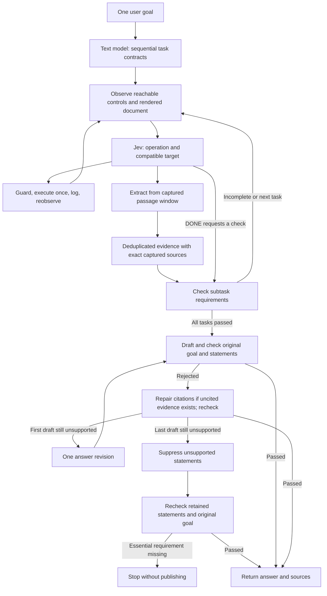

# Hybrid browser agent: local validation

The opt-in `ResearchAgent` wraps Ultrafast's guarded mutation executor with an LLM-generated sequence of outcome contracts, indexed rendered-document passages, source-backed extraction, and separate Jev requirement checks. The original `Agent` and inspector share updated control observations and `PRESS_ENTER`; planning and research verification belong to `ResearchAgent`.

## Scope of this implementation

One owned Chrome tab, one initial plan (1–8 sequential subtasks), up to two planning recoveries, at most 120 decision events and the existing 60-action budget. Replanning retains evidence, observed state and recent actions; the original goal remains the final contract. Reads consume captured immutable passages, including rendered content below the viewport. Hidden content, script text, and form values are excluded from the document reader. Native controls use the shared guarded executor. Snapshot indexing and execution both hit-test the control center, excluding clipped calendar dates and covered targets. Field observations carry input attributes and bounded local context; truncated link text can use an observed full title attribute in the document reader. Every fact includes URL, title, passage ID, content hash, capture time, exact quote and source passage. Matching a quote verifies its presence, not its interpretation; separate semantic checks assess support.

The control and document reads are separate observations. Document identity and URL must agree. Actions retain existing freshness guards; extraction cites its historical capture rather than claiming the page is still unchanged. The reader caps content at 60,000 characters and 400 semantic paragraph chunks and reports truncation. The agent can scroll to reveal omitted controls, but does not yet page through truncated document content. A missing passage is not proof of absence.

Visible text is grouped into semantic paragraphs across inline links and formatting.
Captured passages are offered in windows of at most 200 passages and 6,000 text characters, with READ_NEXT and READ_PREVIOUS
operations to reach other captured windows without browser mutation. This keeps each
TypeSafe Choice question within its 255-option limit. Paging is distinct from document
truncation: it exposes all captured passages but does not retrieve content beyond the
reader's capture cap. Oversized target heads fail locally before a request is sent.
Provider validation errors report their field locations and messages without echoing
the rejected input or authorization key.

Task context is shared once in the TypeSafe state, and repeated verification source
contexts are deduplicated. This bounds the work per reading decision as well as the
number of offered choices. Extraction reads the complete offered section and selects
code-owned passage IDs; code copies those quotations. A malformed extraction gets
one counted generation correction, without repeating browser input. The complete supplied window is then marked read for the current subtask, revision, and content snapshot. Exact duplicate facts (URL, requirement text, value, quote) are not appended again. A 12,000-character budget bounds the evidence records in decision context; each field is capped at 1,200 characters. This is not a cap on the whole request, and complete sources remain stored. Older facts may be omitted from the compact decision view.

Uncertain mutation targets can route to a text-model tie-breaker over compatible
observed targets. Uncertain operations can route to a typed operation/target decision
using the same observed vocabulary. These routes do not manufacture probabilities;
their provenance and model-call counts are retained in the trace. All browser guards
still run. Invalid resolver output is logged and treated as an uncertain decision instead
of crashing or executing it; the existing recovery budgets still apply. Uncertain verification can route to a separate text review requiring a
valid source witness for each supported requirement. Confidently missing requirements
remain incomplete. An invalid review fails closed. Rejected answers get at most one
generation revision, followed by the same goal and statement checks. Before rewriting
or suppressing a rejected draft, citation repair can search uncited stored evidence,
replace numeric references without changing claims, and verify the repaired answer.
Every proposed evidence ID is validated; a missing witness or invalid repair falls back
to the normal revision path. Statements still failing after the last draft can be
suppressed, followed by checks of both the retained statements and the original goal.
Failure of an essential requirement still blocks publication. Suppression means
unsupported under these model checks, not a definitive judgment of falsehood.

Mutation confidence below 0.6, considering both operation and selected target, causes reobservation. Read-only passage choices use an operation-confidence floor of 0.25 and do not reject uncertainty between compatible passages. DONE requests a separate evidence check regardless of selection confidence. Three consecutive uncertain choices, three failed explicit subtask checks, a BLOCKED choice, or an unsupported original-goal check trigger bounded replanning. Exhausting the recovery budget stops the run. Extraction also triggers a subtask check when facts were obtained. Verification requires supported probability at least 0.9 and confidence at least 0.6 for every requirement. These are provisional engineering defaults, not calibrated accuracy claims. A separate original-goal check assesses the candidate answer and executed outcomes, catching requirements omitted by planning. Atomic statements from the generated answer receive another support check against the selected evidence and final page state. This is a model-based assessment, not an independent factual oracle. Original drafts, statement boundaries, citation repairs, and suppressed statements remain in the trace. Only the accepted result is published.

Extracted quotes are resolved to observed source passages, tolerating whitespace changes only; the stored quote preserves the captured source text. Neighboring passages provide interpretation context. Passing a subtask also retains its visible source snapshot, so a result observed without an extraction call survives later navigation. Evidence items therefore include both extracted facts and verified outcome snapshots.

Not implemented yet: dependency graphs, existing-tab attachment, multiple tabs, durable resume, source ranking, frames, shadow DOM, visual fallback, or extracting entire datasets reliably. Traces are saved for audit but cannot be resumed. No general-agent reliability or latency claim follows from this implementation. The research runner is currently a Python API and CLI; the inspector remains the original agent.

Traces report logical model-call counts by planning, decision, extraction, verification, synthesis, typing, target_resolution, decision_resolution, verification_review, and citation_repair when used. HTTP retries can create more provider requests than these logical counts. Total research timing excludes initial planning and browser setup; measure end-to-end wall time separately.

## Runtime architecture

`ResearchAgent` coordinates the run in Python. The configured text model plans outcome
contracts; TypeSafe Jev chooses an operation and its compatible observed target in one
request. The text model also handles field values, extraction, uncertain decisions,
source-witnessed reviews, citation repair and answer generation. Text generation uses
OpenAI-compatible Chat Completions, including direct OpenAI; TypeSafe uses SystemOne.
OpenRouter is optional. No model produces executable selectors or code.



The revised draft goes through the same checks and may also use citation repair.
Verification uses Jev first and a separate source-witnessed text review for uncertain
verdicts. These are model checks, not independent oracles. Cached text is reusable only
when the entire helper input matches; a stale observation never authorizes replaying a
mutation. Invalid field text still stops the run; bounded corrective field generation
has not been implemented. Calendar metadata helps but does not guarantee date selection.

## 1. Offline regression suite — no keys or browser

```bash
uv run ruff check .
uv run pytest
node --check jev_ultrafast/static/app.js
node --check jev_ultrafast/snapshot.js
node --check jev_ultrafast/content.js
uv build
```

The research tests mock every model and browser call. They check invalid plans, fabricated quotes, unknown requirement IDs, operation-specific Enter targets, invalid resolver recovery, extraction-window consumption, fact deduplication, bounded decision evidence, field metadata, human handoff, citation repair, suppression and essential-goal preservation, premature DONE, uncertainty handling, stale documents, suite orchestration and interrupted-observation logging. Existing executor tests remain in the same suite.

## 2. Real local Chrome — no keys or paid APIs

Connect Chrome using Browser Harness, then:

```bash
uv run python scripts/check_guards.py
uv run python scripts/check_research.py
```

`check_research.py` starts an ephemeral loopback HTTP server and opens only the local fixture. Deterministic model doubles drive the production hybrid loop through typing, form submission, navigation, extraction and verification. An API trap fails if any paid model request escapes the doubles. The independent fixture oracle checks Basic $600, Pro $1200, taxes excluded, 30-day cancellation, and the 14-day duplicate-charge exception. It also checks hidden instructions are excluded and offscreen rendered text is readable. Output: `artifacts/research-local-smoke.json`. This checks browser integration, not model competence.

The latest local validation passed 110 offline tests and 24 real-browser guard checks.
The guard fixture covers Enter submission exactly once, clipped calendar controls,
observed field metadata and full link tooltips in addition to freshness and occlusion.

## 3. Live models against a local fixture — paid, opt-in

The research CLI launches isolated Chrome automatically, headless by default.
Add `--headfull` to watch the run, or `--headless` to explicitly hide it. Both flags
work with the installed `jev-research` command and `examples/research.py`.
The CLI closes its temporary profile and dedicated browser connection on exit.
It does not reuse the user's logged-in Chrome profile.

With `--headfull` in an interactive terminal, recognized human-verification messages
pause before model decisions or challenge interaction. Solve the CAPTCHA in Chrome,
then press Enter in the terminal; `q` stops. Resumption discards pending decisions/text
and reobserves the same task tab. Headless/noninteractive runs stop with a reason instead.
Detection is based on common visible messages and can miss framed or differently worded
challenges. Handoff has no timeout. Startup currently leaves two additional blank/setup
tabs visible alongside the single agent task tab.

Do not run this as part of automated tests. Set the same TypeSafe/text-helper credentials used by the existing agent in `.env` (ignored by Git). In one terminal:

```bash
uv run python -m http.server 8770 --bind 127.0.0.1 --directory jev_ultrafast/static
```

In another:

```bash
uv run --env-file .env python examples/research.py \
  --url http://127.0.0.1:8770/research.html \
  --goal 'Use the calculator for five seats. Compare Basic and Pro annual costs, including taxes, cancellation deadlines and refund exceptions.' \
  --trace artifacts/research-live.json
```

Accept only if the actual calculator was submitted for five seats, both prices match, all conditions appear in the answer with valid evidence references, the policy page was actually visited, and no unsupported statement was added. Inspect the saved browser action history and exact source passages independently of the model checks. Repeat five times with fresh agents; retain every failure and all traces. Record success rate, elapsed wall time (including planning), decision/extraction/verification request counts, browser mutation count, and paid usage from provider records. The runner's `elapsed_ms` starts at its first execution tick, excluding initial planning and browser setup; do not report that as total task latency.

The CLI now saves `wall_elapsed_ms` including planning and browser setup, configured model names and policy/fixture source hashes. Check a saved result against fixture ground truth with `uv run python scripts/verify_research_fixture.py artifacts/research-live.json`. The [first live results](research-live-results.md) contain two independent passes and one blocked run on the final policy; they do not establish general reliability. Use your own trace filename in the command.

## 4. Sequential live suite and refinement loop

Use the configured live models to run the seven custom smoke tasks:

```bash
uv run --env-file .env jev-live-suite --headfull
uv run --env-file .env jev-live-suite --headless --flight-date 2026-12-21
uv run --env-file .env jev-live-suite --headfull --only books-first-five books-travel --repeat 3
uv run jev-live-suite --list
```

Task IDs: `flights`, `python-search`, `wikipedia-webb`, `wikipedia-godel`,
`books-identifiers`, `books-first-five`, `books-travel`. Flights defaults to the local
date plus 60 days. Specify a future `--flight-date YYYY-MM-DD` for comparable repeats;
the historical original example still targets September 20, 2026. Mode defaults to
headless. `--repeat` repeats the sequence; `--only` filters in suite order.

Each invocation creates a unique timestamped directory under `artifacts/live-suite/`;
`--output` changes the parent directory. Each task has its own isolated Chrome process,
task definition, raw trace if initialization succeeded, combined terminal log, and result
record. The suite updates `summary.json` after each task and continues after failed
agent processes. Startup failures without traces appear as errors with terminal logs.
Exit code is nonzero if any task fails. Ctrl-C interrupts the suite. A handoff can wait
indefinitely for the user, and tasks have decision/action budgets rather than a global
wall-clock timeout. Outputs may contain page content; credentials stay in `.env`.

The refinement process is: make a scoped change, run offline/browser regressions, rerun
the same live sequence, inspect every failure and successful answer, and save a comparison.
Retain prior runs. Compare completion, actual outcomes, source grounding, wall/loop time,
model calls, evidence growth, repeated actions and human assistance. Keep the date,
mode and model settings consistent when possible; record differences explicitly.

The first pass moved from four agent-completed tasks in the visible baseline to six
in the headless follow-up. Python was CAPTCHA-blocked without assistance; the baseline
was human-assisted. Two other completed tasks became slower. The saved comparison and
limited independent audit are described in [research-live-results.md](research-live-results.md).
These are custom tests, not official WebArena or BrowseComp tasks. The summary field
`independent_verification: not_run` refers to the suite itself; a later external audit
is stored separately and does not overwrite that raw result.

## 5. Expand coverage before optimizing

Add local fixtures for missing answers, conflicting policies, dates and currency normalization, irrelevant similar links, pagination, hidden/collapsed information, delayed loading, stale controls, repeated text, misleading page instructions, and oversized documents. Include navigation-only and reading-only tasks. Keep an independent expected outcome per fixture. A useful blocked result must explain the unmet requirements without inventing completion.

Once those are reliable, benchmark a small read-only set of real sites and compare against the original Agent using identical models, task definitions and starting state. Keep original-speed footage and raw traces. Optimize total verified success per cost and elapsed time, rather than minimizing model calls at the expense of evidence quality.
